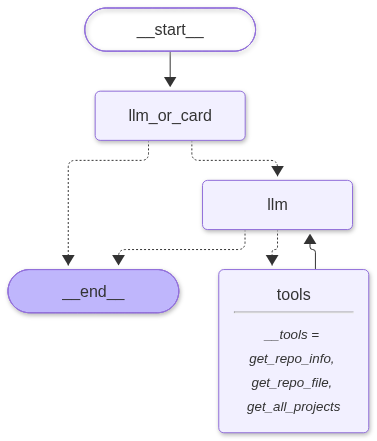

# Portfolio AI Agent

A FastAPI + LangGraph AI agent backend that answers questions about you, your resume, and your GitHub projects—with smart routing for prebuilt portfolio UI cards and real-time Server-Sent Events (SSE) streaming.

Live demo in action: **[ziyadfouda.site](https://ziyadfouda.site)**

---

## How It Works



Every incoming message passes through a two-stage LangGraph workflow backed by `InMemorySaver` (per-`thread_id` conversation memory):

1. **Card Router (`llm_or_card`)** — Classifies whether the user's question can be answered by one of your frontend's prebuilt HTML cards (`Me`, `Projects`, `Skills`, `Fun`, `Contact`) or requires a full LLM response.
2. **LLM + GitHub Repo Tools (`llm` ↔ `tools`)** — When a deeper or follow-up answer is needed (e.g., asking about a specific project's architecture or code), the agent answers using your parsed PDF resume and three PostgreSQL-backed tools:
   - `get_all_projects` — Lists all ingested repositories and their IDs.
   - `get_repo_info` — Fetches a repository's summary and directory tree.
   - `get_repo_file` — Reads the exact content of a specific file inside a repository.

### How Portfolio Cards Work

Instead of burning tokens and adding latency on common portfolio questions (like *"Who are you?"*, *"Show me your projects"*, or *"How can I contact you?"*), the agent supports **prebuilt HTML cards** rendered directly by the frontend (see [ziyadfouda.site](https://ziyadfouda.site) for an example):

- When `llm_or_card` detects a card-eligible question, it skips the main LLM and immediately streams a `card` event (e.g., `{"type": "card", "content": null, "card": "Projects"}`).
- The frontend catches that event and renders the corresponding prebuilt HTML card.
- At the same time, the backend writes the matching text from `UserInfo.CardContent` (`src/github_ai_agent/core/Enums.py`) into the thread's conversation history. This keeps the agent aware of what was displayed on the card so follow-up questions (e.g., *"Tell me more about the second project"*) have full context.

---

## Tech Stack

- **Agent & Orchestration:** LangGraph, LangChain, Groq (`openai/gpt-oss-120b`)
- **API & Streaming:** FastAPI, Uvicorn, Server-Sent Events (SSE), SlowAPI (rate limiting)
- **Repository Ingestion & Storage:** `gitingest`, PostgreSQL (`psycopg2-binary`)
- **Resume Parsing:** `pypdf` (`PyPDFLoader`)
- **Config & Packaging:** Pydantic Settings, `uv` (Python 3.14+)

---

## Project Structure

```text
├── graph.png                              # LangGraph workflow diagram
├── pyproject.toml                         # Dependencies & Vercel entrypoint
├── Procfile / app.json                    # Heroku deployment config
├── .env.example                           # Environment variable template
└── src/github_ai_agent/
    ├── config.py                          # Pydantic settings & DB connection config
    ├── backend/
    │   ├── main.py                        # FastAPI app, CORS, rate limiter, endpoints
    │   └── schemas.py                     # Request models
    ├── core/
    │   ├── Enums.py                       # Your name & card content summaries
    │   ├── assets/
    │   │   └── resume.pdf                 # Your PDF resume
    │   ├── app.py                         # LangGraph graph definition & SSE streaming
    │   ├── nodes.py                       # llm_or_card router & llm/tool nodes
    │   ├── prompts.py                     # Router & agent system prompts
    │   ├── schemas.py                     # Structured output schema (CardDecision)
    │   ├── state.py                       # Graph state definition
    │   ├── llm_model.py                   # ChatGroq model configuration
    │   ├── resume_parser.py               # PDF resume loader
    │   └── tools/
    │       └── repo.py                    # PostgreSQL tools for querying repos/files
    └── repo_to_db/
        └── script.py                      # Ingests GitHub repos into PostgreSQL
```

---

## Customize & Run for Your Own CV and Data

### Prerequisites

- **Python 3.14+** and **[uv](https://docs.astral.sh/uv/)**
- A **PostgreSQL** database (local or hosted)
- A **[Groq API key](https://console.groq.com/)**

### 1. Clone & Install Dependencies

```bash
git clone https://github.com/zFoudaz/portfolio-agent.git
cd portfolio-agent
uv sync
```

### 2. Configure Environment Variables

Copy `.env.example` to `.env` and fill in your credentials:

```bash
cp .env.example .env
```

```env
GROQ_API_KEY=your_groq_api_key
DB_HOST=localhost
DB_PORT=5432
DB_NAME=postgres
DB_USERNAME=postgres
DB_PASSWORD=your_db_password
origins=["http://localhost:3000","https://yourdomain.com"]
```

> **Note:** `origins` must be a valid JSON array of allowed frontend origins for CORS.

### 3. Add Your GitHub Projects (`repo_to_db`)

Open `src/github_ai_agent/repo_to_db/script.py` and replace the `repos` dictionary with your own GitHub repositories:

```python
repos = {
    "my_project_one": "https://github.com/your-username/project-one",
    "my_project_two": "https://github.com/your-username/project-two",
}
```

Then run the ingestion script to create the `REPO` and `FILE` tables in PostgreSQL and populate them using `gitingest`:

```bash
uv run python -m github_ai_agent.repo_to_db.script
```

### 4. Customize Your Profile & Card Content (`Enums.py`)

Open `src/github_ai_agent/core/Enums.py` and update `UserInfo.name` and every entry in `UserInfo.CardContent` to match your own background and portfolio cards:

```python
class UserInfo(Enum):
    name = "Your Name"
    CardContent = {
        "Me": "Short bio, degree, and work experience summary shown on your Me card.",
        "Projects": "Overview of the projects displayed on your Projects card.",
        "Skills": "Your technical stack, soft skills, and certifications.",
        "Fun": "Hobbies, interests, and personal fun facts.",
        "Contact": "mail: you@example.com \n phone: +1234567890 \n linkedin: your-handle \n github: your-handle",
    }
```

> **Tip:** `Contact` is also injected into the agent's fallback prompt when it doesn't know the answer to a question. If you want to add, rename, or remove card categories, update `CardDecision` in `src/github_ai_agent/core/schemas.py` and `LLM_OR_CARD_SYSTEM_PROMPT` in `src/github_ai_agent/core/prompts.py` as well.

### 5. Add Your Resume (`assets/resume.pdf`)

Replace `src/github_ai_agent/core/assets/resume.pdf` with your own PDF resume (keep the filename `resume.pdf`). It is automatically parsed at startup via `PyPDFLoader` and injected into the agent's system prompt.

### 6. Run the Server

Start the FastAPI backend locally:

```bash
uv run uvicorn github_ai_agent.backend.main:app --reload
```

You can also test the agent interactively in your terminal without starting the web server:

```bash
uv run python -m github_ai_agent.core.app
```

---

## API Reference

### `GET /health`

Health check endpoint.

**Response:**
```json
{ "state": "healthy" }
```

### `POST /send_message`

Streams the agent's response as **Server-Sent Events (`text/event-stream`)**. Rate-limited to `10/hour` per client IP.

**Request Body:**
```json
{
  "thread_id": "session-123",
  "message": "How is the authentication implemented in my_project_one?"
}
```

**Streamed Event Formats:**

- **Prebuilt card match:**
  ```text
  data: {"type": "card", "content": null, "card": "Projects"}
  ```
- **Streamed LLM token:**
  ```text
  data: {"type": "token", "content": "The project uses...", "card": null}
  ```
- **End of stream:**
  ```text
  data: {"type": "done"}
  ```

---

## Deployment

- **Heroku:** Ready to deploy out of the box using the included `Procfile` and `app.json`. Set all required environment variables (`GROQ_API_KEY`, `DB_*`, `ORIGINS`) in your Heroku config vars.
- **Vercel:** Entrypoint is preconfigured in `pyproject.toml` under `[tool.vercel]` (`src.github_ai_agent.backend.main:app`).
